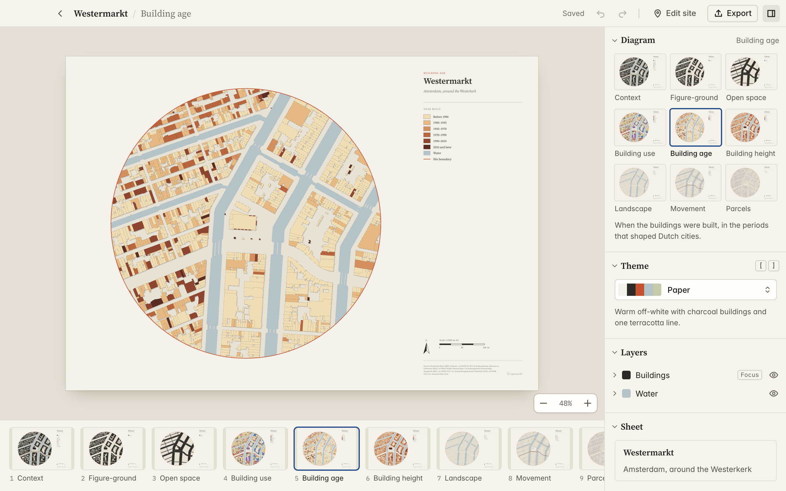
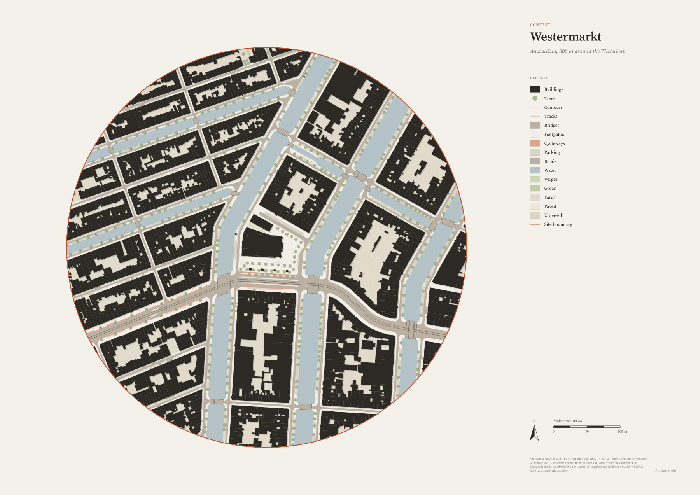
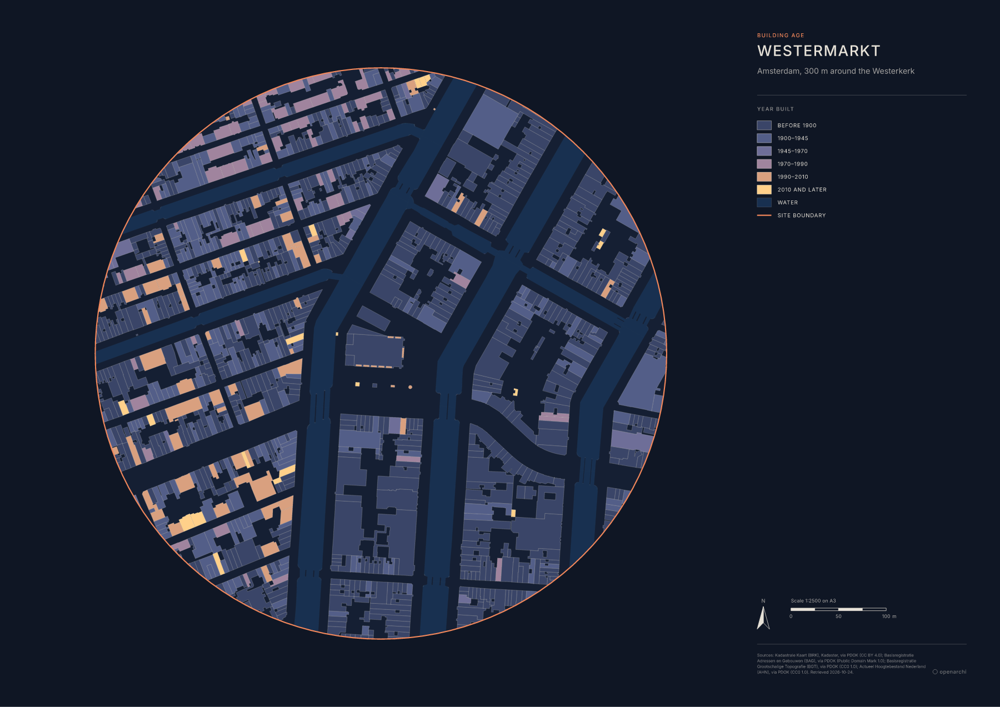
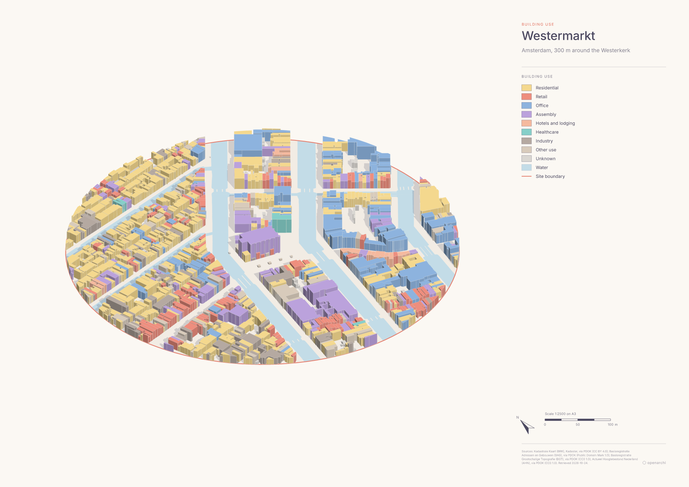
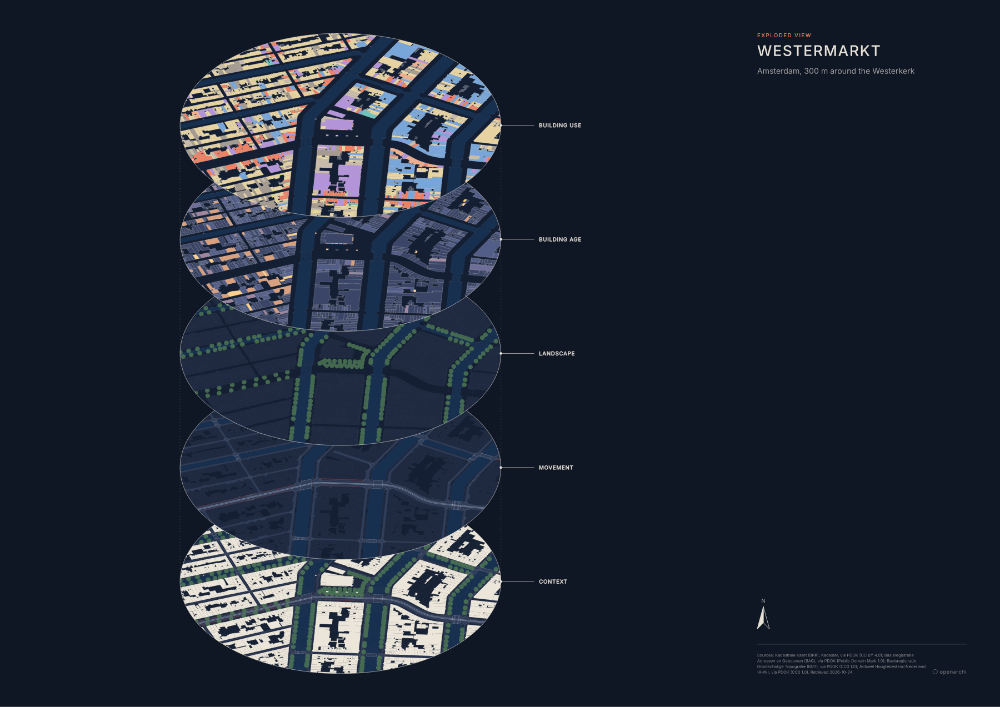

# openarchi

**Site analysis diagrams for architects, free and open source, on Mac and Windows.**

Draw a site, and get a whole series of clean, styled diagrams ready for a board or a portfolio.

## Why this exists

Every architecture project starts with a site analysis, and most students and offices still make those diagrams by hand. You trace the map in Illustrator or wrestle QGIS, then spend hours cleaning up shapes that don't close and roads that are only lines. It should take a minute: draw an area, get a series of styled diagrams.

openarchi does exactly that, and it runs on your own computer, stores your projects as files you own, and has no limits beyond what the data services allow. It starts with the Netherlands, because Dutch open data is unusually good: every road surface, canal and garden is mapped as a real shape, so the drawings come out clean without any cleanup.

In full transparency, openarchi is vibe coded. I described what I wanted and [Claude Code](https://claude.com/claude-code) wrote most of the code, while I tested it and steered it. It's open source, so every line is there to read.

## What it does

- **Twenty-one diagrams from one site.** Context, figure-ground, open space, building use, building age, building height, parcels, movement, transit, walkability, business, facilities, landscape, slope, flood depth, noise (road traffic or all sources), air quality (NO₂, PM10 or PM2.5), population, dwellings, sun path and shadow. Each one answers one question, and the column on the left lists the whole series in its groups.
- **The neighbourhood on foot.** Walk times of 5, 10 and 15 minutes from the site over the real footpath network, with the schools, shops, health care and transit stops within reach.
- **A site analysis with design notes.** Where the site is, what is on it, and its climate: temperature, outdoor comfort, wind roses by season, sun and humidity from a typical year, and thirty years of rain from the nearest weather station. Under each chart a few plain sentences say what it means for a design, Outdoor comfort is the UTCI felt temperature in the sun and in the shade. Every chart exports as SVG or PDF in the sheet's palette, and the whole analysis as a PDF of numbered A4 pages.
- **The site in three dimensions.** An axonometric view stands every building up at its measured height, lit by the sun at the date and time you choose, and an explode view stacks several diagrams as plates so you can read them against each other.
- **The site in its surroundings.** Every view can show the neighbourhood around the site, greyed in the sheet's palette, so the site reads in its street and block while staying the thing you look at.
- **Palettes that keep a series together.** Eight built-in palettes (Paper, Ink, Mono, Polder, Blueprint, Terracotta, Midnight, Pastel) restyle every diagram at once, so a set of sheets reads as one family. Make your own from a few colours picked by hand or pasted from a palette generator's export; openarchi gives each colour its job and checks the contrast. Tweak any layer's fill, line or opacity on top.
- **Real data, cleanly drawn.** Buildings with year built, use and height, road surfaces at their true width, water, green, trees, parcels and terrain contours, from the Dutch government's open registers.
- **Reports you lay out yourself.** Drag ratios, analysis charts, design notes, whole sheets and your own text onto A4 to A1 pages, drawn live in the palette you choose, and export the report as one PDF or an SVG or PNG per page.
- **Several sheets per site, with your own landmarks.** Each tab is its own sheet, and can zoom in on part of the site, with ratios for just that part. Drag pins, stars, flags or dots onto the sheet and label them; they show on every sheet.
- **Sheets ready to print.** A3 to A0 or a square for social posts, at a real scale like 1:2500, with a legend, north arrow, scale bar and the data credits.
- **Exports that open properly.** SVG and PDF with named layers for Illustrator, Affinity and InDesign, PNG at any resolution, and DXF in real Dutch coordinates (RD New) for AutoCAD and Rhino.
- **Laser cutting files for a site model.** Choose a scale, a board and your laser's bed, and get one file per bed: the site as a base plate with streets and footprints scored on it, and every building as a stack of numbered pieces, packed and ready for the model workshop.
- **Hard to lose work.** Projects save as you go, every save keeps a backup, ⌘Z undoes every change, and deleted projects wait in Recently Deleted.
- **Works with your AI assistant.** Connect Claude or another assistant over MCP and ask it to make a site, try diagrams and palettes, or design a new palette. Its changes show up live in the open app. See [docs/mcp.md](docs/mcp.md).

<table>
  <tr>
    <td></td>
    <td></td>
  </tr>
  <tr>
    <td align="center">Context, in Paper</td>
    <td align="center">Building age, in Midnight</td>
  </tr>
  <tr>
    <td></td>
    <td></td>
  </tr>
  <tr>
    <td align="center">Building use as an axonometric, in Pastel</td>
    <td align="center">Five diagrams exploded, in Midnight</td>
  </tr>
</table>

## Downloading it

Download the installer for your computer from the [latest release](https://github.com/HNagouda/openarchi/releases/latest). It's under "Assets" at the bottom of that page.

- **Mac:** `openarchi_<version>_universal.dmg` runs on both Apple Silicon and Intel Macs, on macOS 11 or newer. Open it and drag openarchi into Applications.
- **Windows:** `openarchi_<version>_x64-setup.exe` is the usual installer. The `.msi` installs the same app, for computers that only accept MSI packages.

The installers aren't signed yet, which costs a yearly fee from Apple and a certificate for Windows. So the first time you open openarchi, your computer warns you about it:

- **On a Mac**, right-click openarchi in Applications and choose Open, then Open again. On macOS 15 and newer that button is gone: click Done, open **System Settings > Privacy & Security**, scroll down and click **Open Anyway** next to the message about openarchi. If macOS says the app is damaged, run `xattr -dr com.apple.quarantine /Applications/openarchi.app` in Terminal and open it again.
- **On Windows**, SmartScreen says "Windows protected your PC". Click **More info**, then **Run anyway**.

You only need to do this once. Each release also lists `SHA256SUMS.txt`, to check a download is the file that was published. If you want to try the newest work before it's released, the [dev build](https://github.com/HNagouda/openarchi/releases/tag/dev-build) is rebuilt from the `dev` branch after every change.

## Using it

1. **Draw a site.** Press ⌘N, search for an address, and draw a circle, rectangle or polygon around it (C, R or P). Sites can be up to 4 km².
2. **Fetch it.** openarchi downloads the buildings, surfaces, parcels and terrain for that area. A 300 m circle takes a few seconds.
3. **Pick a diagram and a palette.** Pick a diagram in the column on the left, or step through them with ↑ and ↓. [ and ] step through palettes. The sheet updates as you go.
4. **Export.** Press ⌘E for this diagram or the whole series, as SVG, PDF, PNG or DXF, or as laser cutting files for a site model.

The first time you open openarchi, a short tour walks through this. Help > Show Tour opens it again.

## Shortcuts

On Windows, Ctrl takes the place of ⌘.

- **⌘N** starts a new project, **⌘O** or **Return** opens the selected one, and **Delete** moves it to Recently Deleted.
- **C**, **R** and **P** draw a circle, rectangle or polygon. **Return** finishes a polygon and **Esc** stops drawing.
- Click a drawn site to select it, then drag it to move it or drag a handle to resize it. **Delete** removes it.
- **↑** and **↓** step through the diagrams, **←** and **→** switch a diagram's measure (NO₂, PM10 or PM2.5 for air quality), and **[** and **]** step through palettes.
- **T** adds a text box. With a text selected, **Return** edits it, the arrow keys nudge it (with **⇧** by 10 mm) and **Delete** removes a text box.
- In a report, the arrow keys nudge the selected block (with **⇧** by 10 mm), **⌘D** duplicates it, **⌘]** and **⌘[** bring it forward or send it back, and **Delete** removes it. **T** adds a text box to the current page, and **Esc** lets go of the selected block.
- **Ctrl+Tab** and **Ctrl+⇧+Tab** step through the sheet tabs, as do **⌘⌥→** and **⌘⌥←** on a Mac. With a pin selected, **Return** edits its label, the arrow keys nudge it and **Delete** removes it.
- **⌘Z** undoes the last change to the site or the sheet and **⇧⌘Z** redoes it (**Ctrl+Y** also redoes on Windows).
- **⌘=** and **⌘−** zoom the map or the sheet, and **⌘0** fits the site or the sheet back in the window.
- **⌘E** exports, **D** hides or shows the diagram column and **I** the inspector.
- **⌘,** opens settings and **⌘/** lists every shortcut.

## Where the data comes from

Everything comes from open Dutch government data through [PDOK](https://www.pdok.nl): the large-scale topography map (BGT) for road surfaces, water, green and trees, the building register (BAG) for footprints, year built and use, the cadastral map (BRK) for parcels, and the national elevation model (AHN) for building heights and contours. BGT, BAG and AHN are public domain. BRK is CC BY 4.0, which is why every sheet prints its credits by default.

Businesses, facilities, transit stops and the footpath network come from [OpenStreetMap](https://www.openstreetmap.org/copyright) through the Overpass API, in one query per site. That data is © OpenStreetMap contributors under the ODbL 1.0, and every sheet that shows it says so.

The Analysis tab adds the climate from [PVGIS](https://joint-research-centre.ec.europa.eu/photovoltaic-geographical-information-system-pvgis_en), the European Commission's Joint Research Centre, as a typical year of hourly weather, and rain from the nearest [KNMI](https://www.knmi.nl/nederland-nu/klimatologie/daggegevens) weather station (CC BY 4.0). The municipality comes from Kadaster's administrative boundaries and the country outline from CBS, both CC BY 4.0 through PDOK. Every analysis page lists the sources it used.

## Questions

**Is it really free?** Yes. No subscription, no account, no cap on sites.

**Does it work outside the Netherlands?** Not yet. Other countries need their own data sources, and each one is a small, self-contained module, so this is a good place to contribute.

**Found a bug, or have an idea?** [Open an issue](https://github.com/HNagouda/openarchi/issues/new/choose).

## For developers

openarchi is a Rust core with a Tauri and React app on top. [DEVELOPMENT.md](DEVELOPMENT.md) explains how it fits together and how to build it.

## License

Free and open source under the [GNU General Public License v3.0](LICENSE).
